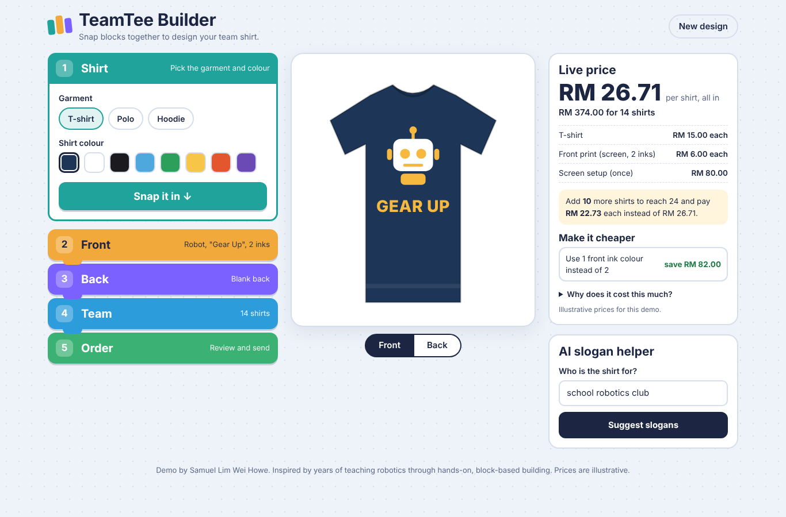
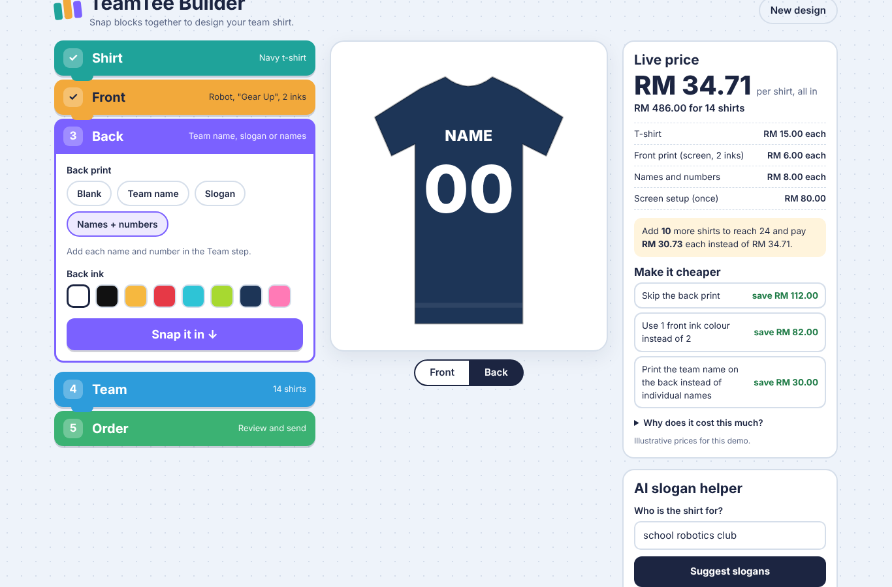

https://teamtee-builder.samuellim83.workers.dev/ # TeamTee Builder

**Design a team T-shirt by snapping blocks together.** A live mockup updates as you build, the price explains itself as you go, and a small AI model suggests slogans.

Built by **Samuel Lim Wei Howe** as a portfolio project for apparel-printing software.

> Live demo: _add your Cloudflare URL here after deploying_




## Why I built it

For nearly four years I was a robotics trainer, teaching students and teachers with LEGO Education kits. Children learn fastest when they **build something with their hands and see the result straight away**.

School clubs and robotics teams all want team shirts, but ordering them is painful for teachers. They have to design something, chase everyone's sizes and wait for quotes by email. Many simply don't bother. TeamTee Builder turns that chore into a hands-on build, so these teams become new customers for print shops.

### The idea as a Blue Ocean strategy

| Move | What TeamTee Builder does |
|---|---|
| **Eliminate** | The email back-and-forth for quotes and sizes |
| **Reduce** | The design skill needed, and costly extra ink colours |
| **Raise** | Price transparency and student involvement |
| **Create** | A fun, block-based build that doubles as a mini lesson on how printing works |

## What it does

1. **Shirt block:** pick a T-shirt, polo or hoodie and its colour.
2. **Front block:** choose an original graphic, type the team name and pick up to four ink colours.
3. **Back block:** leave it blank or add the team name, a slogan, or each person's name and number.
4. **Team block:** set how many shirts of each size, and optionally fill in a name and number for each shirt.
5. **Order block:** copy a share link, copy a ready-made team chat message, or print a job ticket for the print shop.

Along the way:

- **Live price.** Shows the price per shirt and the total, with a line-by-line breakdown.
- **Smart method choice.** Picks screen printing or digital (DTG) printing, whichever is cheaper for the order, and explains why.
- **"Make it cheaper".** Computes real savings, such as using fewer ink colours or skipping the back print, and applies them in one tap.
- **Price-break nudge.** Says when a few more shirts would lower the price per shirt.
- **AI slogan helper.** Uses a small Llama model on Cloudflare Workers AI. If the AI is unavailable, the app falls back to built-in ideas so it never breaks.
- **Installable and offline-friendly.** Works as a PWA, and drafts are saved in the browser.
- **Accessible.** Supports keyboard use and screen readers, and respects reduced-motion settings.

Prices in the app are illustrative, for teaching how print pricing works.

## How it's built

| Part | Technology |
|---|---|
| App | React 19, TypeScript, Vite |
| Mockup | Hand-drawn SVG, no image files |
| Pricing | Pure TypeScript functions (`src/lib/pricing.ts`) with unit tests |
| AI | Cloudflare Worker (`worker/index.ts`) calling Workers AI (`@cf/meta/llama-3.2-3b-instruct`) |
| Hosting | One Cloudflare Worker serves the static app and the `/api/suggest` endpoint |
| Tests | Vitest: pricing rules and the AI endpoint, using a fake AI binding |

The API key problem doesn't exist here: the Worker uses Cloudflare's built-in AI binding, so no key ever reaches the browser. Workers AI includes a free daily allowance. When it runs out, the endpoint returns 503 and the app switches to built-in slogan ideas.

### Project map

```
src/
  App.tsx                 layout, state, job ticket
  components/
    BuildStack.tsx        the snap-together blocks and each step's controls
    ShirtMockup.tsx       live SVG shirt (front and back)
    Graphic.tsx           original vector graphics
    PricePanel.tsx        live price, savings, price-break nudge
    AIHelper.tsx          slogan helper with offline fallback
    OrderPanel.tsx        share link, team chat message, print
  lib/
    pricing.ts            pricing engine (+ pricing.test.ts)
    state.ts              defaults, share links, saved drafts
    fallback.ts           built-in slogans
    types.ts              shared types
worker/index.ts           Cloudflare Worker: /api/suggest (+ index.test.ts)
public/                   PWA manifest, service worker, icons
```

## Run it locally

You need Node.js 20 or newer.

```bash
npm install
npm run dev        # open http://localhost:5173
npm test           # run the unit tests
npm run build      # production build into dist/
```

In local development the AI endpoint isn't running, so the helper shows the built-in ideas. That's the fallback working as designed.

## Deploy free on Cloudflare

1. Create a free Cloudflare account.
2. In this folder, run `npx wrangler login` and approve in the browser.
3. Run `npm run deploy`. This builds the app and deploys the Worker with the AI binding.
4. Wrangler prints your live URL, such as `https://teamtee-builder.<your-subdomain>.workers.dev`. Paste it at the top of this README.

## How I used AI to build it

I built this with AI coding tools, then reviewed, tested and debugged the code myself. That review included the pricing rules, the input cleaning in the Worker and the share-link parsing, which checks every field so a broken link can't crash the app. The unit tests cover the parts where a mistake would cost money: the price calculation and the AI endpoint.

## Ideas for next steps

- Let teammates add their own size from the share link (needs a small database, such as Cloudflare D1).
- Upload a team logo, and reduce it to a set number of ink colours automatically.
- Send the order straight into print shop software through an API.
